### Opa! Marcos Wellington aqui! 👋

Engenheiro de software sênior em **.NET** e **Azure**, com mais de 8 anos de estrada. Hoje trabalho num ERP de grande porte para operações logísticas e financeiras — mais de 20 microsserviços .NET, frontend React e um SDK interno compartilhado — onde lidero tecnicamente um time de 8 pessoas e conduzo a adoção de IA na engenharia.

Boa parte do que eu escrevo é código privado, então os números abaixo contam também o trabalho que não aparece como repositório público por aqui.

<!-- cool-readme:start -->
<!-- Cards by github-cool-readme: https://github.com/pedrocatalao/github-cool-readme -->

<picture>
  <source media="(prefers-color-scheme: dark)" srcset="https://raw.githubusercontent.com/marcoswoc/marcoswoc/cards/about-dark.svg">
  
</picture>
<picture>
  <source media="(prefers-color-scheme: dark)" srcset="https://raw.githubusercontent.com/marcoswoc/marcoswoc/cards/summary-dark.svg">
  
</picture>

<picture>
  <source media="(prefers-color-scheme: dark)" srcset="https://raw.githubusercontent.com/marcoswoc/marcoswoc/cards/languages-dark.svg">
  
</picture>
<picture>
  <source media="(prefers-color-scheme: dark)" srcset="https://raw.githubusercontent.com/marcoswoc/marcoswoc/cards/weekly-dark.svg">
  
</picture>

<!-- cool-readme:end -->

#### No que eu trabalho

- **IA aplicada em produção** — assistentes com RAG e busca híbrida (BM25 + kNN), agentes que deixam o cálculo num motor determinístico fora do LLM, avaliação por golden sets e acompanhamento de custo por modelo.
- **Arquitetura .NET** — Clean Architecture, DDD, CQRS, mensageria e observabilidade sobre Azure.
- **Plataforma de engenharia** — fluxo de entrega por pacote de funcionalidades, políticas automáticas de PR, onboarding em um único comando e uso padronizado de IA no desenvolvimento.

Antes disso, passei cinco anos em sistemas de crédito e meios de pagamento: crédito direto ao consumidor, cartão, registro de boleto e integração entre instituições.

#### Caixa de ferramentas

`C#` `.NET` `ASP.NET Core` `EF Core` `SQL Server` `Elasticsearch` `Azure` `Azure DevOps` `Azure OpenAI` `Docker` `React` `TypeScript`

#### Formação

- Pós-graduação em Inteligência Artificial para Desenvolvedores — **FIAP**
- Graduação em Sistemas de Informação — **UCL, Faculdade do Centro Leste**
- Microsoft Certified: Azure Fundamentals (**AZ-900**)

#### Onde me achar

[Site](https://marcoswoc.net) · [LinkedIn](https://www.linkedin.com/in/marcoswoc/) · [X](https://twitter.com/marcoswoc)
